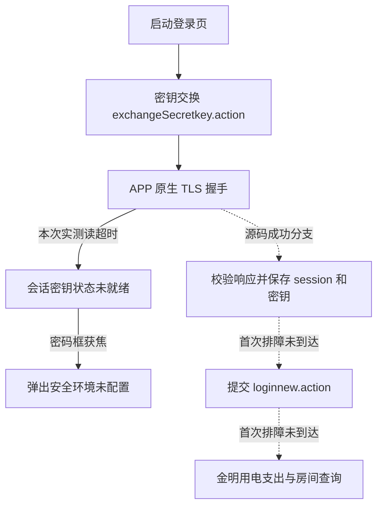

# 完美校园 5.8.19 环境与早期认证排障

本页保留安装、证书信任及早期登录失败记录。2026-11-18 用户切换网络后成功进入用电支出，后续只读实测见[电费接口](electricity-api.md)。

## 范围

仅测试用户授权账号；目标入口为「金明 → 缴费 → 用电支出 → 选择房间」。不执行充值、支付、风控或证书校验绕过。原 APK、原 AVD、项目业务代码均保留。

## 环境

- 使用现有 Android Emulator 37.1.11、API 30 Google APIs ARM64 userdebug。
- 独立 AVD 为 `wmxy30`，serial 为 `emulator-5580`，4 核 / 4 GB RAM / 6 GB 数据分区。
- 已验证开机、UID 0、overlayfs remount、原始 APK 安装和启动。
- APK SHA-256：`fd450ff247e78ba9a01c4d3a5a9669d09876765a6afdf9be633a49487aa3ea74`。
- 包名 `com.newcapec.mobile.ncp`，minSdk 24 / targetSdk 30。
- 实测 CA 路径 `/system/etc/security/cacerts`；没有 `/apex/com.android.conscrypt/cacerts`。
- Android 默认 TrustManager 对照：安装 CA 前 `Trust anchor for certification path not found`；安装后 HTTP 200，TLS 1.3 套件，签发者 mitmproxy；冷启动后重复通过。

## 加固与代码来源

原始 DEX 只有 5 个类，入口为 `com.stub.StubApp`，包含 360 加固资产。原始 JADX 输出不能代表业务代码已分析。

在用户授权范围内，使用已有 Frida 17.17.0 只读扫描目标主进程内存，提取有效 DEX，不替换方法、不修改返回值。`analysis/runtime-dex/index.json` 记录每份数据的 SHA-256、大小与 class_defs_size；重复内存副本按 SHA-256 合并文件。

业务 DEX：`d9a08cee04599d0379732ce8b01ea0057db33fe8cca6de7218587cc5d526c2be`，6,483 个 class_defs。JADX 导出的 Java 文件数与该值不同，不据此声称全量恢复。

编译期字符串通过已加载类的 `StubApp.getString2(int)` 读取，映射保存在 `analysis/static-strings.json`。只读取指定源码引用的常量；没有读取账号密码或替换解密函数。

## 原生认证链的静态证据

- `EnvironmentConfig` / `WebUrl.mainService()`：默认 `https://app.17wanxiao.com/campus/`，备用主域 `59wanmei.com`。
- `ChangeKeyReqData` / `AbstractNetRequestProcess.changeKey()`：`cam_iface46/exchangeSecretkey.action`；客户端生成 RSA 密钥对，交换会话和对称密钥。
- `LoginReqData`：`cam_iface46/loginnew.action`，含登录类型、账号、密码列表或 token，以及设备与版本字段。
- `TripleDESEncry`：请求 JSON 采用 `session` / `data` 包装；data 为 DESede/CBC/PKCS5Padding 加密后 Base64，IV 为编译期常量。
- `LoginBeforeNetRequestImpl` / `LoginAfterNetRequestImpl`：对发送的包装字符串求 SHA-256，放入 `campusSign` Header；校验响应签名，再按相应响应形式解密。
- 自动登录/Token 类型存在代码分支；未完成真实刷新验证，不代表可独立长期续期。

## 客户端独立证书信任库

`AbstractNetRequestProcess.buildNetRequest()` 指定 `server.cer` 和主机名；`DefaultHttpsNetRequest.getKeyStore()` 从应用资产构建独立 KeyStore，`getSSLContext()` 使用该 KeyStore 初始化 TrustManager，POST 明确设置该 SSL socket factory。

这与 Android 系统 CA 信任是两条路径。两个认证域名通过代理时保持原样 TLS。在停止代理后，模拟器默认 TrustManager 直连两个域名均完成 TLS 握手，访问 `/campus/` 得到 404 和 405。这两个响应只记录连通性。

## 登录前失败点

初次测试正常启动原始 APK 后，点击空密码框即可复现「安全环境未配置成功，请稍后再试」。该次直连复测关闭了任务代理和 Frida 服务，当时尚未提交密码登录。后续重试记录见[登录排障旧计划](auth-handoff-plan.md)。

`LoginAndRegistActivity` 的密码焦点回调读取 `getChangeKeyStatus()`，为 false 时调用 `showNoKeyDialog()`。状态只能在 `AbstractNetRequestProcess.changeKey()` 收到 HTTP 200、解开响应、校验业务成功并保存 session 与 key 后变为 true。隐藏提示不会建立这个会话。

目标进程的 `logcat` 在 `changeKey → DefaultHttpsNetRequest.request → Conscrypt.startHandshake` 记录 `SocketTimeoutException`。保留异常类型和函数名的证据在 `evidence/login-init-failure.json`。尚无证据判定超时由域名切换、网络路径或客户端 TLS 差异中的哪一步引起。

## 后续核验边界

切网后，官方 APP 已通过用户授权账号进入用电支出，历史条目查询及 APP / Python 对照有记录。切网前失败连接的确切网络路径、原生认证成功报文、完整房间目录、自动续期及关停 AVD 后的查询仍无实测证据。[电费接口](electricity-api.md) · [脱敏对照记录](../evidence/electricity-webview-requests.jsonl)

## 参考

- [Android Emulator 命令行与 writable-system](https://developer.android.com/studio/run/emulator-commandline)
- [Android 系统代理](https://developer.android.com/studio/run/emulator-networking-proxy)
- [Conscrypt 信任库版本差异](https://source.android.com/docs/core/ota/modular-system/conscrypt)
- [Frida Android](https://frida.re/docs/android/)
- [河大办事指南，第 176 页「学生宿舍用电购置流程」](https://www.henu.edu.cn/__local/F/9E/C9/7DDDADDF226A3A82C6B8DD6B9F4_EADE588B_101AAB4.pdf#page=191)。学校列出的入口为完美校园 APP、绑定校园卡、缴费、用电支出。
